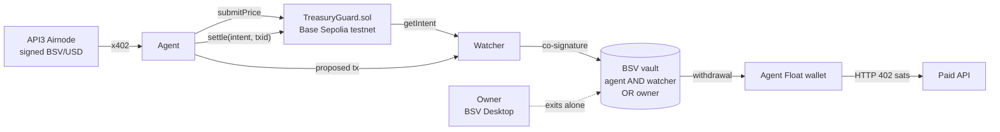

# Treasury Guard

**A dollar budget for AI agents that pay in sats. Base Sepolia decides, BSV mainnet moves the money, and the owner can always exit alone.**

TUM Blockchain & AI Hackathon 2026, BSV track ("DeFi Rails for Agentic Payments") and API3 track.

AI agents are starting to pay for APIs, data and compute themselves. Giving an agent a wallet key is a blank cheque: one prompt injection or bug, and the wallet is empty. Treasury Guard gives the agent freedom to act, but not unlimited freedom to spend:

1. The owner's sats sit in a **BSV vault script** that only **agent + watcher together** can spend, and that the **owner can always spend alone**.
2. A **daily USD budget** lives in `TreasuryGuard.sol` on **Base Sepolia**. The contract turns a **signed API3 BSV/USD price** into a SPEND intent with a hard `maxSats`.
3. An independent **watcher** reads the intent and co-signs **one** BSV withdrawal for it. It signs only if the real transaction pays the registered Agent Float no more than `maxSats`, fee included, and returns the rest to the vault.
4. The agent's model (Claude or DeepSeek) decides what to buy. A **guardian** in the float wallet enforces the merchant allowlist, the declared price and the caps. The agent then pays an **HTTP 402** API in sats.
5. DeFi rail: **atomic swap-and-pay** turns sats into a token and pays a token-only merchant in **one** BSV transaction.

> An API3 intent alone cannot move money. No BSV transaction can move money out of the vault unless that intent authorises it, or the owner is exiting.

## Live, end to end (30 Oct 2026)

| Step | Network | Transaction |
| --- | --- | --- |
| Owner funds the vault, then **exits alone** (safety gate before anything else) | BSV mainnet | [cdcbf706…](https://whatsonchain.com/tx/cdcbf706af70c65ecc04b65c3b9ddfecc6626a9cda3088a5312afcebc541e81f) → [db5ca41c…](https://whatsonchain.com/tx/db5ca41c82c4506f66614193b6c2ccf5b84f3d7afffcda4f1a588b09edf7d41e) |
| Owner funds the vault with 5,000 sats | BSV mainnet | [c1f97102…](https://whatsonchain.com/tx/c1f971027a2f0015a19c5945a48adf1282d5b1bb9cf8ab3f4e16d7574e246ad4) |
| Signed BSV/USD → SPEND **intent 2** (`maxSats` 2,896) | Base Sepolia | [0x0aa95a72…](https://sepolia.basescan.org/tx/0x0aa95a723942c63e0463ea8730e4cb2baf8f76ac272b98915c31b8f0130afc90) |
| Watcher checks the raw tx and co-signs: 2,796 sats → Agent Float, 2,162 back to the vault, fee 42 | BSV mainnet | [ae35d469…](https://whatsonchain.com/tx/ae35d46939d7fd7f79ff32aab1d6bdc906d28a18da93cce3950c013ccc91dcf5) |
| `settle(2, txid)`, read back as `settled = true` | Base Sepolia | [0xc1a8c9bb…](https://sepolia.basescan.org/tx/0xc1a8c9bb236698e05a51293e337369ab9ea6284b97d863e0a66257c2844de5b8) |
| Agent pays an HTTP 402 API: 1,000 sats, HTTP 200 in 857 ms | BSV mainnet | [43c8255e…](https://whatsonchain.com/tx/43c8255e63ab363f9d3641a601e74aee5ea95b5d53b747fcc86c40d71e959b77) |
| Intent 4 → withdrawal into the dedicated float wallet (2,062 sats) → agent's model (DeepSeek) decides BUY → guardian → HTTP 402 that spends exactly that withdrawal output | Base Sepolia + BSV mainnet | [`452a42b4…a31f`](https://whatsonchain.com/tx/452a42b4bf518451c9c4f48a270af892b5b2adb74b64ac8a76bbd5319285a31f) → [`54082a71…b320`](https://whatsonchain.com/tx/54082a714816ce2e9b2a67c23c5e04da67c2f93b8df30136b7126b715802b320) → [settle(4)](https://sepolia.basescan.org/tx/0x793e7f26270e8a688239a42128cfa4916842d27c6309f5beaf6bb9dca3ffc980) |
| Intent 5 through the **separate watcher process** (HTTP): withdrawal 5,781 sats → DeepSeek BUY → HTTP 402 from that output; replaying intent 5 → 409, intent 3 (vault 8) → 422 | Base Sepolia + BSV mainnet | [`85b74fb5…0002`](https://whatsonchain.com/tx/85b74fb5c959f7f239d854ac89d292b932cac4aa243801aa0e1815f8fe020002) → [`6cf0ff26…6134`](https://whatsonchain.com/tx/6cf0ff26409e0173d663ad2893a4e3d24306defd9fa81a01882d64de3d2a6134) |
| Atomic swap-and-pay: 1,000 sats to the maker, 1 pUSD to the merchant, one tx | BSV mainnet | [ee2a3896…](https://whatsonchain.com/tx/ee2a38964df993af6cd48f5f51d1ce0c07c7bf454363735341288d7f71bf8e8c) |

A second withdrawal for intent 2 was refused live (`journal already holds this intent as broadcast`). The full record, including what is live and what is mocked, is in [`bsv/docs/evidence/RESULTS.md`](bsv/docs/evidence/RESULTS.md).

## Usage and value

**Who it is for.** Teams that run AI agents and want them to buy things on their own (paid APIs, data feeds, compute), and agent platforms that hold money for many agents. Many of them build on EVM chains today.

**How they use it.**
1. The owner creates a vault on Base (daily USD budget, agent key) and funds a BSV vault from their own wallet (BSV Desktop).
2. The agent asks for budget with a signed price. The watcher releases sats to the agent's float wallet only within that budget.
3. The agent spends the float on HTTP 402 APIs, or through swap-and-pay for merchants that want a token. The guardian checks every payment.
4. The owner can take everything back at any time with one transaction, without asking anyone.

**Why BSV.** Agents pay in tiny amounts and often. On BSV the vault withdrawal paid a 42-sat network fee and the 402 payment a 23-sat fee, both under $0.00001 at ~$17/BSV. A payment was answered in under one second. Scripts let the vault rules live in the coin itself, so no custodian is needed.

**What it brings to BSV.** Budgets are set in dollars on an EVM chain that agent teams already use, so an EVM agent team can start paying on BSV without moving its control logic. Every such agent becomes a BSV user with real transaction volume. The DeFi rail lets a merchant ask for a token while the agent holds only sats. More: [`bsv/docs/USAGE_AND_VALUE.md`](bsv/docs/USAGE_AND_VALUE.md).

## Run it

| Part | Where | Commands |
| --- | --- | --- |
| BSV side: vault, watcher, Agent Float, HTTP 402, swap-and-pay | [`bsv/`](bsv/README.md) | `cd bsv && npm ci && npm test && npm run typecheck` (58 offline tests), `LIVE_BASE=1 npm test` (adds live Base reads) |
| API3 side: contract, client, judge script | [`api3/`](api3/README.md) | `cd api3 && pnpm install && forge test && pnpm test`; live judge: `node --env-file=.env src/judge.ts --dry` |

The mainnet runbook (the `tg` CLI) is in [`bsv/docs/DEMO_RUNBOOK.md`](bsv/docs/DEMO_RUNBOOK.md). The design and checks are in [`bsv/docs/INTEGRATION.md`](bsv/docs/INTEGRATION.md) and [`bsv/docs/SAFETY_AND_TRUST.md`](bsv/docs/SAFETY_AND_TRUST.md).

## Trust assumptions, and what we do not claim

- Base does not verify BSV. `settle` is a record written by the agent, not a cross-chain proof. Enforcement lives in the BSV script and the watcher.
- The watcher can block but cannot take funds. If it goes offline, the owner exits alone (proven on mainnet).
- API3 signatures prove origin, integrity and time, not economic correctness.
- pUSD is an unbacked demo token, not a stablecoin. There is no CDP, liquidation, peg or bridge.
- The watcher runs as its own local process with its own key; intents 2 and 4 used the earlier in-process mode, intent 5 the separate process, and a separate host is the production step. The signed-rate swap wrapper is tested offline only.

## Repository layout

This repository is a fork of [bsv-blockchain/ts-stack](https://github.com/bsv-blockchain/ts-stack). The hackathon work is in two folders:

| Folder | What | Owner |
| --- | --- | --- |
| [`api3/`](api3/README.md) | `TreasuryGuard.sol`, API3 signed data, x402, TypeScript client, judge script | API3 side |
| [`bsv/`](bsv/README.md) | Vault script, watcher, Agent Float, guardian, HTTP 402, swap-and-pay, mainnet CLI | BSV side |

Everything else is the upstream ts-stack monorepo, unchanged. Its README is [`README.ts-stack.md`](README.ts-stack.md). Part of the swap rail was prototyped before the event in [Brezn610/BSV_pet](https://github.com/Brezn610/BSV_pet); provenance is in [`bsv/README.md`](bsv/README.md#provenance).
