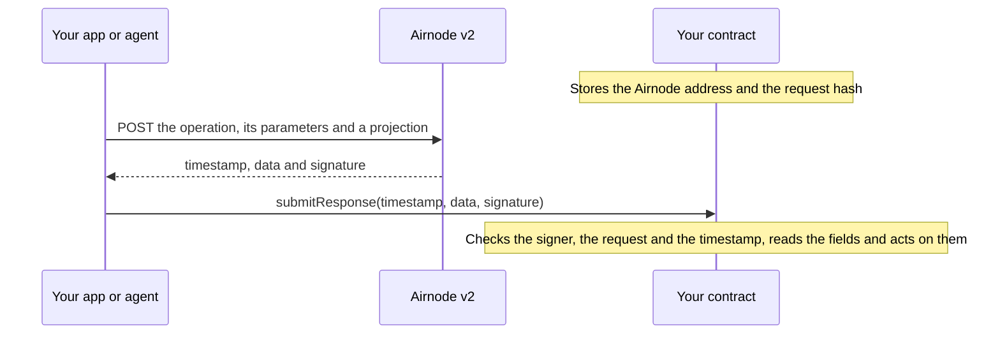

# Treasury Guard (API3 part)

AI agents pay in sats, but their owners think in dollars and fear volatility and runaway spending. Treasury Guard keeps
the agent's money in a vault on BSV that the agent can only move together with a watcher, and the owner can always exit
alone. The watcher co-signs only what `TreasuryGuard.sol` on Base Sepolia allowed, and the contract allows something
only after it verified signed AirnodeHub data: a BSV/USD price (CoinPaprika) or a post of a whitelisted X account
(TwitterAPI.io). This folder is the API3 part: the contract, its tests, a TypeScript client and the judge script. It does
not depend on BSV. Design: [`docs/TEAM-BRIEF.md`](docs/TEAM-BRIEF.md), interface for the BSV side:
[`docs/INTERFACE.md`](docs/INTERFACE.md), all details: [`API3-NOTES.md`](API3-NOTES.md).

What the contract does with the signed data:

1. **Dollar budget, paid in sats.** The owner sets a daily budget in USD (e.g. $5/day). `submitPrice` turns a USD amount
   into a SPEND intent with `maxSats = usdAmount / signed price` and debits the budget.
2. **Circuit breaker.** The same signed price carries the 1h change. At or below the owner's threshold the vault goes
   `RISK_OFF` and a SWAP intent (sats → stablecoin) is created inside a band around the signed price. No LLM in this path.
3. **News guard.** A signed post of a whitelisted account plus a signed price plus an analyst verdict can create a hedge
   intent capped at 25 % of the vault.

## Who relies on the data, and what goes wrong if it is forged

| Who                 | Relies on                                                                                                    |
| ------------------- | ------------------------------------------------------------------------------------------------------------ |
| Owner               | the USD budget is converted to sats at a price nobody could pick                                             |
| Watcher (BSV side)  | it co-signs a BSV tx only if it matches an intent on Base (`maxSats`, `maxBps`, band, expiry)                |
| Liquidity providers | a swap only fills inside `minOut`/`maxOut`, the signed price ∓ slippage                                      |
| Auditors, anyone    | every intent stores the price and when it was signed, every accepted value is an event with its request hash |

If the data could be forged:

- **Forged low price** → `maxSats` grows → the agent overspends in sats while staying "within" its dollar budget.
- **Forged 1h change** → a needless hedge (swap fees, wrong position), or a real crash that never trips the breaker.
- **Forged price in a swap** → the band moves and the LP or the vault trades at a wrong rate.
- **Forged, old or retweeted post** → a hedge on news the account never posted, or posted hours ago (capped at 25 %).

So the contract checks, for every response: the request hash against the one stored per vault (never the one in the
response), the signer against the stored Airnode address, the signature age (5 min), the age of the measured value
(10 min) and of the post (30 min), and replay (a price must be newer than the last one, a post id counts once).

**What a signature does not prove.** An API3 signature proves who said what, and when, and that the data was not changed.
It does not prove the content is true. That is why the larger rule-based moves (budget, breaker hedge 50 %) use only signed price data, and the post-driven
hedge is capped at 25 %. The analyst verdict is signed off-chain; only its hash is emitted in `PostVerified`, it is not
verified on-chain.

## Data we could not find on AirnodeHub

- **No BSV/USD on Nodary** (155 feeds, checked 29 Oct). We buy BSV/USD from the CoinPaprika Airnode via x402
  (`getTickersById`, `coin_id: bsv-bitcoin-sv`, $0.001 per call in aUSD).
- **No retweet flag in TwitterAPI.io `userLastTweets`.** A retweet only has a `retweeted_tweet` object. Projecting it
  costs ~3.8 KB per response, and projecting `/retweeted_tweet/id` returns HTTP 400 when it is null. We project
  `{id, text}` of `/data/tweets/0` and reject text starting with `RT @` (`NotOriginalPost`). In our sample, 13 of the 20
  newest @WhiteHouse posts were retweets.
- **Posts of a brand-new X account were not visible.** For our new demo account @TreasuryGuardDe, `userLastTweets`
  returned an empty list for 30+ min after a public original post, while an older account's post showed up within
  seconds. So the demo uses the older account @956_kakashi.
- **No machine-readable post time.** `createdAt` comes as `Fri Oct 30 13:00:51 +0000 2026`, not ISO 8601, so the
  contract derives the post time from the tweet id (Snowflake).
- Limitation, not missing data: a value in exponent notation (`-1e-7`) reverts in `ProjectedJson`. Unlikely for a
  percentage; the agent then skips the cycle.

## For judges

|            |                                                                                                                                                                                                                                            |
| ---------- | ------------------------------------------------------------------------------------------------------------------------------------------------------------------------------------------------------------------------------------------ |
| Contract   | TreasuryGuard [`0x8e38cc6B1Bd1f0D25357066cd0036f28fd1f7773`](https://sepolia.basescan.org/address/0x8e38cc6b1bd1f0d25357066cd0036f28fd1f7773), Base Sepolia (84532), verified                                                              |
| Deploy     | tx [`0xfc0219e4…`](https://sepolia.basescan.org/tx/0xfc0219e499276dc10e6bdfd3f8005158ebaa14f02957dc86fd355c440c7ed884), block 52226250                                                                                                     |
| Vaults 1–4 | superseded (1/3 agent, 2/4 judge): same configs, fewer whitelisted accounts                                                                                                                                                                |
| Vault 5    | the team's agent loop, $1/day (config of vault 3), tx [`0x8500b5dd…`](https://sepolia.basescan.org/tx/0x8500b5dd6ceed76c867b2029a58e6f460b302b1a5663f4d7437bf824247c2e5a), block 52248781                                                  |
| Vault 6    | judge vault: $100/day counter, holds no funds, agent = the team's deployer key (config of vault 4), tx [`0x3b32dc30…`](https://sepolia.basescan.org/tx/0x3b32dc30f9701ef9e3fac4a3c7fa956a2b677b09ab78f415465b956ac91cd893), block 52248793 |
| Feeds      | CoinPaprika BSV/USD `0x18b78216…399480`, TwitterAPI.io @WhiteHouse, @federalreserve and the demo accounts @956_kakashi and @TreasuryGuardDe, full hashes in [`deployments.json`](deployments.json)                                         |
| \1\n       | Post path (live, `--dry`)                                                                                                                                                                                                                  | on judge vault 6, `checkEvent` accepts a real fresh original post of @956_kakashi: the news guard works with real signed data |

**Tamper test.** Check order for a price: request → signer → signature age → replay → budget, so a cached fixture still
shows its own error. All fixtures in [`test/fixtures/`](test/fixtures/) are real signed responses, bought once via x402.

| Case                      | Input                                        | Expected revert                          | Fixture                                           | Forge test                                    | Live in judge script   |
| ------------------------- | -------------------------------------------- | ---------------------------------------- | ------------------------------------------------- | --------------------------------------------- | ---------------------- |
| Valid + fresh             | fresh BSV/USD price, amount ≤ budget         | none, SPEND intent created               | `coinpaprika-bsv-usd.json`¹                       | `test_valid_freshPriceCreatesSpendIntent`     | yes (sends a tx)       |
| Edited value              | one digit of `data` changed                  | `SignerMismatch(recovered)` `0x64fd0fbe` | `coinpaprika-bsv-usd.json`                        | `test_tamper_editedValue`                     | yes                    |
| Wrong key                 | re-signed with a local key                   | `SignerMismatch(that key)` `0x64fd0fbe`  | `coinpaprika-bsv-usd.json`, re-signed (`vm.sign`) | `test_tamper_wrongKey`                        | yes                    |
| Other request             | CoinPaprika BTC/USD, same signer             | `WrongRequest(0xcadca27a…)` `0x4a161c51` | `coinpaprika-btc-usd.json`                        | `test_tamper_wrongRequest_btcInsteadOfBsv`    | yes                    |
| Too old                   | signature older than 5 min                   | `StaleSignature()` `0x480cfdff`          | `coinpaprika-bsv-usd.json`                        | `test_tamper_tooOld`                          | yes                    |
| Replay                    | the same response twice                      | `Replay()` `0xb5a78004`                  | `coinpaprika-bsv-usd.json`                        | `test_tamper_replay`                          | yes (not with `--dry`) |
| Over budget               | amount > remaining today                     | `BudgetExceeded(remaining)` `0x19af843d` | `coinpaprika-bsv-usd.json`                        | `test_tamper_budgetExceeded`                  | yes (simulated)        |
| Old post, fresh signature | @federalreserve, post 16.6 h old when signed | `StalePost()` `0x7f1d2c82`               | `twitterapi-federalreserve.json`                  | `test_tamper_stalePost_oldPostFreshSignature` | Forge only             |
| Retweet                   | @WhiteHouse, text `RT @CENTCOM: ...`         | `NotOriginalPost()` `0x579354d1`         | `twitterapi-whitehouse.json`                      | `test_realRetweetIsNotOriginalPost`           | Forge only²            |

¹ In Forge the valid case uses `vm.warp` to the fixture's signing time. On the live contract a cached fixture is stale;
the valid case needs a freshly bought price. ² `--post <account>` buys the latest real post and shows what
`checkEvent` says about it, which depends on what the account posted last.

Run it locally: `forge test` (all cases, no network needed).

**Check any response yourself, no key and no gas.** `checkPrice` and `checkEvent` run the same checks as the writes and
can be called by anyone via `eth_call`. Example with a cached fixture against the live contract:

```bash
TG=0x8e38cc6B1Bd1f0D25357066cd0036f28fd1f7773
F=test/fixtures/coinpaprika-btc-usd.json   # or coinpaprika-bsv-usd.json → StaleSignature, or your own response
cast call $TG 'checkPrice(uint256,(bytes32,uint256,bytes,bytes))((uint256,int256,uint256,uint256))' 2 \
  "($(jq -r .requestHash $F),$(jq -r .timestamp $F),$(cast from-utf8 "$(jq -r .data $F)"),$(jq -r .signature $F))" \
  --rpc-url https://sepolia.base.org
# execution reverted, data 0x4a161c51cadca27a… = WrongRequest(0xcadca27a…)
```

Edit a digit of `data`, swap the signature or bring a fresh price, and the revert tells you which check stopped it.

**Judge script.** [`src/judge.ts`](src/judge.ts) buys one fresh signed BSV/USD price via x402 (0.001 aUSD), runs every
price case above against the live contract as a free `eth_call`, sends one valid `submitPrice` that creates a real SPEND
intent, then shows `Replay`: `node --env-file=.env src/judge.ts [--dry] [--post WhiteHouse]`. It signs with the vault's agent
key (`PRIVATE_KEY`), pays x402 with `PAYER_PRIVATE_KEY` (from the environment, else from `.env.agent`), defaults to the
judge vault and refuses the agent vault from `deployments.json`. We run it live on the judge vault (`deployments.json` → `judgeVaultId`). To run it yourself, create your own vault with `createVault` (anyone can;
you become its owner, set yourself as agent) and pass `--vault <id>`; your key then needs Base Sepolia ETH and aUSD from
the [faucet](https://api3dao.github.io/airnodehub-hackathon/faucet/). Set `RPC_URL`, `PRIVATE_KEY` (the vault's agent) and
`PAYER_PRIVATE_KEY` (pays x402, may be the same key) in `.env`.

## Real vs demo

- **Real:** the verified contract on Base Sepolia, the Airnode signatures, the x402 payments in aUSD (e.g. the
  [BSV/USD purchase](https://sepolia.basescan.org/tx/0x71b12c9ead04e0891898547b6a1206e4c77dfb6aac73eaa31c716e64a2b1e4c7)),
  the tamper cases above on real fixtures. The BSV side (vault, watcher, payments) runs on BSV mainnet with tiny amounts.
- **Demo:** Base Sepolia, not Base mainnet (x402 in aUSD only exists there). The live vault runs a $1/day budget. The
  stablecoin on BSV is a demo token and not redeemable. One team-run watcher and LP. News-guard demo posts come from
  @956_kakashi, an existing account of the team, not an official one. The circuit breaker is not expected to fire live: a −5 % hour of BSV is rare, and we never loosen thresholds to
  force it. Its logic is shown in Forge tests with a local test signer (−6.25 % in 1 h → `RISK_OFF` + 50 % hedge intent,
  re-entry only after the cooldown, `forge test --match-test breaker`). Live, it fires only on a real crash.
- The agent loop and the watcher are built by the BSV side of the team on top of the client in
  [`src/client/`](src/client/); they are not part of this folder.

## Roadmap

- **Stable-first mode.** The vault holds the stablecoin and swaps to sats only for each spend, so there is no price
  risk to guard against. The trade-off: every payment becomes a swap (fees, needs live LP liquidity), and the risk moves
  to the stablecoin issuer. The signed price stays necessary: each swap must fill inside the band around it. Today's
  design is for owners who hold sats and hedge only on a verified crash.

---

# AirnodeHub hackathon starter template

Bring signed API data into your contract. This template fetches an ETH/USD price that the
[Nodary](https://airnodehub.api3.org/explore/nodary) Airnode v2 signed, verifies the signature on-chain and reads the
price out of the signed JSON. Copy the libraries in `contracts/` into your project, or fork the repo and inherit from
`NodaryPriceConsumer`.

Everything here is for Airnode v2, the version of Airnode that serves the APIs on AirnodeHub.

## How it works



1. **Pick the request before any data exists.** The request is an operation, its parameters and a projection. Its hash
   depends only on these, so you compute it off-chain (`pnpm request-hash`) and store it in the contract together with
   the address that the Airnode signs with.
2. **Fetch a signed response.** The projection cuts Nodary's response down to the two fields that the contract needs:

   ```sh
   curl --request POST https://airnode-nodary.fly.dev/ \
     --header 'Content-Type: application/json' \
     --data '{
       "operation": "latestFeeds",
       "parameters": { "name": "ETH/USD" },
       "responseProjection": { "price": "/ETH~1USD/value", "updatedAt": "/ETH~1USD/timestamp" }
     }'
   ```

   This response is real, so you can test your own verifier with it:

   ```json
   {
     "airnode": "0xE70f1e8b22a21e4Bb5188918a3033341b281E4c0",
     "requestHash": "0x180eae9387bb66a72380e61ebe0a00d19f8414a716a37ebe1df124b66acfff66",
     "timestamp": "1792403240",
     "data": "{\"price\":2443.95,\"updatedAt\":1792403240691}",
     "signature": "0xb034c17a11679ff06e50445c84419c34ba0aee5669bbda3a0dd563d2437928a17e5b34826fd505b0d1cace3712570df07de0d0a7eb2e1610c84cd4a0d71827e21b"
   }
   ```

3. **Submit it.** Anyone can send `timestamp`, `data` and `signature` to the contract: a user, a keeper bot or an agent.
   `data` is the string that the Airnode signed, `{"price":2443.95,"updatedAt":1792403240691}`. Send its bytes as they
   are, such as `toHex(response.data)` with viem, without parsing it and writing it again.
4. **The contract checks the response, then reads it.** From
   [`NodaryPriceConsumer`](contracts/examples/NodaryPriceConsumer.sol):

   ```solidity
   AirnodeV2Attestation.verify(AIRNODE_V2, requestHash, timestamp, data, signature);
   if (timestamp + MAX_RESPONSE_AGE < block.timestamp) revert ResponseTooOld(timestamp);
   uint256 price = ProjectedJson.readUint(data, "price", 18);
   uint256 priceTimestamp = ProjectedJson.readUint(data, "updatedAt", 0) / 1000;
   if (priceTimestamp + MAX_PRICE_AGE < block.timestamp) revert PriceTooOld(priceTimestamp);
   consumePrice(price, priceTimestamp);
   ```

5. **Your contract uses the price.** `NodaryPriceConsumer` is abstract. Inherit from it and implement `consumePrice`,
   which runs only for a price that passed every check. [`NodaryPriceLogger`](contracts/examples/NodaryPriceLogger.sol)
   is the smallest implementation:

   ```solidity
   contract NodaryPriceLogger is NodaryPriceConsumer {
       event PriceConsumed(uint256 price, uint256 priceTimestamp);

       constructor(bytes32 requestHash_) NodaryPriceConsumer(requestHash_) {}

       function consumePrice(uint256 price, uint256 priceTimestamp) internal override {
           emit PriceConsumed(price, priceTimestamp);
       }
   }
   ```

## Quick start

You need [Foundry](https://getfoundry.sh), [Node.js](https://nodejs.org) 22.18 or later and [pnpm](https://pnpm.io).

```sh
git clone --recurse-submodules https://github.com/api3dao/airnodehub-hackathon-starter.git
cd airnodehub-hackathon-starter
pnpm install
forge test
pnpm test
```

To run the whole flow on a local chain, start `anvil` in one terminal, then run this in another:

```sh
cp .env.example .env
REQUEST_HASH=$(pnpm --silent request-hash) forge script script/DeployNodaryPriceLogger.s.sol \
  --rpc-url http://127.0.0.1:8545 --broadcast
pnpm submit-response
```

`submit-response` fetches a fresh response, checks it off-chain, sends it to the contract and prints the price from the
`PriceConsumed` event:

```
Submitted {"price":2421.42,"updatedAt":1792411032300} in transaction 0xdd98d5fd18692ddef6ab7ff8f07d31d1ff8cf14ed88521f8380eb5a8c9df4939
The contract consumed the price 2421.42, taken at 2026-10-19T11:57:12.000Z
```

To deploy on a testnet, put your own `PRIVATE_KEY` and `RPC_URL` in `.env`, run the deploy command with your RPC URL
after `--rpc-url`, and set `CONSUMER_ADDRESS` to the address that the script prints.

| Command                                            | What it does                                                                         |
| -------------------------------------------------- | ------------------------------------------------------------------------------------ |
| `pnpm request-hash [feed name] [--passthrough]`    | Prints the request hash, without calling the Airnode.                                |
| `pnpm fetch-response [feed name] [--passthrough]`  | Fetches a signed response, checks it and prints it with `data` as the signed string. |
| `pnpm submit-response [feed name] [--passthrough]` | Fetches a signed response, checks it and submits it to `CONSUMER_ADDRESS`.           |
| `pnpm submit-response --file <response.json>`      | Submits the response in the file to `CONSUMER_ADDRESS`, without the off-chain check. |

The feed name is `ETH/USD` unless you give another one, such as `BTC/USD`. To see every feed that Nodary serves, call
`latestFeeds` without parameters. The scripts call `POST /` unless you give `--passthrough`, which sends Nodary's own
`GET /api/feed/latest?name=ETH/USD` instead. The two routes give different request hashes, so deploy and submit with the
same feed and the same route.

### Paying for a priced operation

A priced operation answers `402` until the call comes with an x402 payment. Set `PAYER_PRIVATE_KEY` in `.env` to an
account that holds testnet aUSD on Base Sepolia, and the scripts pay for such a call. The account needs no ETH, because
the facilitator submits the transfer. In your own code, pass the fetch from [`createPayingFetch`](src/x402.ts) to either
fetch function:

```ts
const payingFetch = createPayingFetch(payerPrivateKey);
const signedResponse = await fetchSignedResponse(airnodeUrl, request, payingFetch);
```

`createPayingFetch` wraps `fetch` with the [`@x402/fetch`](https://www.npmjs.com/package/@x402/fetch) client. It pays
only in aUSD, and at most one dollar for a call.

The scripts print the transaction that settled each payment, so you can show the payment in a demo:

```
The payment settled in transaction https://sepolia.basescan.org/tx/0x…
```

They print it to stderr, so `pnpm --silent fetch-response > response.json` saves only the response. In your own code,
read the settlement from the response of a paid call with [`readPaymentSettlement`](src/x402.ts), as
[`createScriptFetch`](src/script-options.ts) does.

## What is in the template

| Path                                                                                       | What it is                                                                                                                                                                                                                                                                                                                                 |
| ------------------------------------------------------------------------------------------ | ------------------------------------------------------------------------------------------------------------------------------------------------------------------------------------------------------------------------------------------------------------------------------------------------------------------------------------------ |
| [`contracts/AirnodeV2Attestation.sol`](contracts/AirnodeV2Attestation.sol)                 | `verify` reverts unless the Airnode signed the data as its response to the request. `recoverSigner` returns the signer.                                                                                                                                                                                                                    |
| [`contracts/ProjectedJson.sol`](contracts/ProjectedJson.sol)                               | `readUint`, `readInt`, `readBool`, `readString`, `readTimestamp`, `readAddress`, `readBytes32` and `readHexUint` read a top-level field of the signed JSON by its name, with Solady's JSON parser, and `isNull` tells whether it is null. `escapePointerToken` escapes a key for a pointer of the projection, so ETH/USD becomes ETH~1USD. |
| [`contracts/IsoTimestamp.sol`](contracts/IsoTimestamp.sol)                                 | `parse` reads an ISO 8601 date or date-time, such as `2026-10-23 10:55+02:00`, as a Unix timestamp. `ProjectedJson.readTimestamp` uses it.                                                                                                                                                                                                 |
| [`contracts/examples/NodaryPriceConsumer.sol`](contracts/examples/NodaryPriceConsumer.sol) | Abstract contract that checks a signed Nodary response, reads the price and passes it to `consumePrice`.                                                                                                                                                                                                                                   |
| [`contracts/examples/NodaryPriceLogger.sol`](contracts/examples/NodaryPriceLogger.sol)     | Implements `consumePrice` by emitting an event. Replace the event with your own logic.                                                                                                                                                                                                                                                     |
| [`script/DeployNodaryPriceLogger.s.sol`](script/DeployNodaryPriceLogger.s.sol)             | Deploys `NodaryPriceLogger`.                                                                                                                                                                                                                                                                                                               |
| [`src/airnode-v2.ts`](src/airnode-v2.ts)                                                   | For your app or agent: `deriveRequestHash` and `fetchSignedResponse` for `POST /`, `derivePassthroughRequestHash` and `fetchSignedPassthroughResponse` for the passthrough, and `verifySignedResponse` for both.                                                                                                                           |
| [`src/nodary.ts`](src/nodary.ts)                                                           | The Nodary Airnode's URL and address, and the price request with its projection for each route.                                                                                                                                                                                                                                            |
| [`src/x402.ts`](src/x402.ts)                                                               | `createPayingFetch`, a fetch that pays for a priced operation over x402, in aUSD on Base Sepolia. `readPaymentSettlement` reads the transaction that settled a payment.                                                                                                                                                                    |
| [`test/`](test)                                                                            | Tests, including the tamper test. [`test/fixtures`](test/fixtures) holds real signed responses that `pnpm fetch-response` saved.                                                                                                                                                                                                           |

## The three checks

The [tamper test](https://api3dao.github.io/airnodehub-hackathon/docs/#judging) of the hackathon sends your contract a real
response with an edited value, a real response that is too old for your use case, a real response to a different
request and a response signed with the wrong key. The example contract rejects all four
([tests](test/NodaryPriceConsumer.t.sol)), because it checks three things:

- **The signer.** Compare the recovered address with an Airnode address that your contract stores. Never trust the
  `airnode` field or the `X-Airnode-Address` header, because whoever forges a response sets those too. The Airnode's
  address is in the `x-airnode` extension of the document that a `GET` of its URL returns.
- **The request.** The request hash covers the operation, its parameters and the projection. `verify` puts the stored
  hash into the digest, so a real response to another request, such as another feed, flight or city, recovers a
  different signer. If your contract handles many requests, such as one for each bet, store a hash when you create each
  bet, or
  [build it in the contract](https://api3dao.github.io/airnodehub-hackathon/docs/from-api-to-contract#build-the-hash-in-the-contract)
  from the bet's parameters.
- **The time.** `timestamp` is when the Airnode signed. The signature covers it, so you can trust it after `verify`.
  Decide what fresh means for your contract. Anyone can submit the same response again, and `NodaryPriceConsumer`
  leaves that to `consumePrice`: accept only a price that is newer than the last one, or let each bet settle only once.

The data can have its own timestamp, such as Nodary's `updatedAt`. It tells you how old the value was when the Airnode
signed it. A fresh signature can cover an old value. For example, Nodary updates the ankrETH/ETH exchange rate about
once a day, so a response that the Airnode signed a second ago can carry a value that is a day old
([test](test/NodaryPriceConsumer.t.sol)). Check both timestamps when the age of the value matters.

### Check that your contract is tamper-proof

A contract that accepts a real response can still accept a forged one, so check that yours rejects every bad response
too. `pnpm submit-response --file <response.json>` sends the response in a file to the contract as it is, without the
off-chain check, so the contract has to reject a bad response on its own. Save a response with
`pnpm --silent fetch-response > response.json`, change it for each case below and submit it. Each case should revert:

| Case            | What to do with `response.json`                                                                                            | The example contract reverts with                 |
| --------------- | -------------------------------------------------------------------------------------------------------------------------- | ------------------------------------------------- |
| Edited value    | Change a digit of the price in `data`.                                                                                     | `NotSignedByAirnode` with an unknown signer       |
| Too old         | Nothing. Wait until it is older than your contract accepts, such as `MAX_RESPONSE_AGE` in the example, and then submit it. | `ResponseTooOld`                                  |
| Another request | Save `pnpm --silent fetch-response BTC/USD` instead, for a contract deployed for ETH/USD.                                  | `NotSignedByAirnode` with an unknown signer       |
| Wrong key       | Replace `signature` with a signature from another key, as shown below.                                                     | `NotSignedByAirnode` with the address of that key |

The Airnode signs the digest `keccak256(abi.encodePacked(requestHash, timestamp, data))` with EIP-191. To sign it with
another key, put the values from the file into these commands:

```sh
digest=$(cast keccak $(cast abi-encode --packed 'f(bytes32,uint256,bytes)' <requestHash> <timestamp> $(cast from-utf8 '<data>')))
cast wallet sign --private-key <another private key> $digest
```

The script prints the error of the contract:

```
Error: The contract rejected the response with NotSignedByAirnode(0x8eA5736F12d9D798c2D6AD37420d199555359792)
```

Also add the four cases to your Forge tests, as [`NodaryPriceConsumer.t.sol`](test/NodaryPriceConsumer.t.sol) does,
so that they run again after each change to the contract.

## Projections

A projection maps field names that you choose to [JSON Pointers](https://datatracker.ietf.org/doc/html/rfc6901) into
the full response. A pointer writes `/` in a key as `~1` and `~` as `~0`, so the key `ETH/USD` becomes `/ETH~1USD`.

- **The projection is signed.** The request hash includes it, and the signed `data` is the projected object. So a
  contract that stores the request hash knows which fields `data` has.
- **The fields come in the byte order of their names**, whatever order the request used. So a request hash always comes
  with the same field order, such as `{"price":…,"updatedAt":…}`.
- **At most 20 fields**, each with its own pointer that starts with `/`. A pointer cannot be inside the value of another
  pointer, such as `/flights/0` with `/flights/0/status`, or the Airnode answers with `400`. For the whole response,
  send no projection.
- **Project single values.** `ProjectedJson` reads single values in top-level fields. To read inside a projected
  object, use Solady's `JSONParserLib` directly, such as `JSONParserLib.parse(string(data)).at('"feed"').at('"value"')`.
- **A pointer to a field that is not there fails.** The Airnode answers with `400` and signs nothing, so you cannot get
  a signed proof that a field is missing.
- **A pointer reaches array elements only by index**, such as `/flights/0/status`. Make sure that the upstream API
  keeps the order of the array stable.

The [passthrough](https://airnodehub-docs.api3.org/airnode/http-interface) takes the same projection as query
parameters (`x-airnode-project=price:/ETH~1USD/value`). It returns the signature in `X-Airnode-*` headers and the
projected JSON as the body, which is `data`. It derives the request hash in a different way, so a contract that stores
one hash accepts responses from only one of the two routes.
[From API to contract](https://api3dao.github.io/airnodehub-hackathon/docs/from-api-to-contract#choose-a-route) compares the two.

## Reading the data on-chain

`ProjectedJson` parses the data with Solady's
[`JSONParserLib`](https://github.com/Vectorized/solady/blob/v0.1.26/src/utils/JSONParserLib.sol) and turns decimal
numbers into integers with the number of decimals that you ask for:

| Signed data                                              | Call                                                        | Result                                       |
| -------------------------------------------------------- | ----------------------------------------------------------- | -------------------------------------------- |
| `{"price":2443.95}`                                      | `readUint(data, "price", 18)`                               | `2443950000000000000000`                     |
| `{"price":2443.959}`                                     | `readUint(data, "price", 2)`                                | `244395`, the extra digit is cut off         |
| `{"price":0.00000012}`                                   | `readUint(data, "price", 18)`                               | `120000000000`                               |
| `{"temperature":-12.5}`                                  | `readInt(data, "temperature", 1)`                           | `-125`                                       |
| `{"isFinal":true}`                                       | `readBool(data, "isFinal")`                                 | `true`                                       |
| `{"status":"Landed"}`                                    | `readString(data, "status")`                                | `"Landed"`                                   |
| `{"mid":"0.0005"}`                                       | `readUint(data, "mid", 18)`                                 | `500000000000000`                            |
| `{"funding":"-0.0000125"}`                               | `readInt(data, "funding", 9)`                               | `-12500`                                     |
| `{"winnerId":null}`                                      | `isNull(data, "winnerId")`                                  | `true`                                       |
| `{"endDate":"2024-11-05T12:00:00Z"}`                     | `readTimestamp(data, "endDate")`                            | `1730808000`                                 |
| `{"departure":"2026-10-23 10:55+02:00"}`                 | `readTimestamp(data, "departure")`                          | `1792745700`                                 |
| `{"vault":"0xE70f1e8b22a21e4Bb5188918a3033341b281E4c0"}` | `readAddress(data, "vault")`                                | `0xE70f1e8b22a21e4Bb5188918a3033341b281E4c0` |
| `{"balance":"0x1bc16d674ec80000"}`                       | `readHexUint(data, "balance")`                              | `2000000000000000000`                        |
| `{"outcomePrices":"[\"1\", \"0\"]"}`                     | `readUint(bytes(readString(data, "outcomePrices")), 0, 18)` | `1000000000000000000`                        |

- **Verify before you read.** Only the signature makes the data trustworthy. Invalid JSON reverts with
  `JSONParserLib.ParsingFailed`, a missing field with `FieldNotFound` and a value of the wrong type with
  `UnexpectedValue`.
- **Compare strings by their hash**, such as
  `keccak256(bytes(ProjectedJson.readString(data, "status"))) == keccak256("Landed")`. With a projection of one field,
  you can also skip the parser and compare `keccak256(data)` with the hash of each outcome that you expect.
- **Numbers arrive as the API wrote them.** The Airnode copies each value from the text of the API response, so an
  integer of any size, such as an amount in wei, keeps every digit. A number has exponent notation only if the API
  writes it that way, and `readUint` and `readInt` revert on it. `JSON.stringify` writes numbers below 0.000001 that
  way, such as `1.2e-7`, so an API that runs on JavaScript can send one for a very small price.
- **Some APIs write numbers as strings**, such as the Polymarket CLOB and Hyperliquid, so that no JSON parser rounds
  them. `readUint` and `readInt` read a number with or without quotes, so a field that an API writes both ways, such as
  Morpho's `totalAssets`, reads the same. A projection cannot remove the quotes, because a pointer selects a whole value.
- **Check for null first.** An API often writes `null` for a value that is not known yet, such as the winner of a
  PandaScore match that has not ended. The other functions revert on `null`, so branch on `isNull`, for example to
  wait or to refund.
- **Times.** `readTimestamp` reads an ISO 8601 date or date-time as Unix seconds, with
  [`IsoTimestamp.parse`](contracts/IsoTimestamp.sol). The time can follow a `T` or a space, its seconds and their
  fraction are optional, and it ends with `Z` or an offset such as `+02:00`, `+0200` or `+02`. A date-time without an
  offset reverts, because it is the local time of a place that the data does not name. A time before 1970 reverts
  too, because a Unix timestamp in a `uint256` starts there, so an old date, such as when an old company was founded,
  does not read. If the API also gives the time as a number, such as Visual Crossing's `datetimeEpoch`, project that
  number instead.
- **Hex strings.** `readAddress` and `readBytes32` take only the full 40 or 64 digits, because leading zeros are part
  of the bytes, and a shorter string could have lost zeros at either end. `readHexUint` reads a number of any length,
  such as a balance from Ethereum JSON-RPC, which drops leading zeros. For an API that drops the leading zeros of an
  id, `bytes32(readHexUint(data, "id"))` puts them back in front.
- **JSON inside a string.** Polymarket writes `outcomes`, `outcomePrices` and `clobTokenIds` as JSON arrays inside
  strings, such as `"[\"Yes\", \"No\"]"`. No pointer reaches inside a string, so project the whole string, and read
  its items with the overloads of `readUint` and `readString` that take an index.
- **Gas and size.** Reading a field costs about 17,000 gas, because each read parses the whole object. `submitResponse`
  in the example costs about 63,000 gas, plus whatever `consumePrice` does. `AirnodeV2Attestation` and `ProjectedJson`
  add about 6 KB to a contract, a quarter of the 24 KB limit.

## Use another API

1. Find a listing on [AirnodeHub](https://airnodehub.api3.org), or connect your agent to the MCP server at
   `https://airnodehub.api3.org/mcp` and use `search-listings`. A `GET` of the Airnode's URL returns its operations,
   their parameters and the address that it signs with.
2. Call the operation once without a projection to see the full response. Then write a pointer for each field that your
   contract needs.
3. Build the request the way [`buildPriceRequest`](src/nodary.ts) does for `POST /`, or
   [`buildPricePassthroughRequest`](src/nodary.ts) does for the passthrough. Compute its hash with
   [`deriveRequestHash`](src/airnode-v2.ts) or [`derivePassthroughRequestHash`](src/airnode-v2.ts). Every response to
   that request carries the same `requestHash`, so you can also copy it from one call. If the contract gets a parameter value on-chain, such as a flight number for each policy,
   build the hash in the contract instead, as
   [From API to contract](https://api3dao.github.io/airnodehub-hackathon/docs/from-api-to-contract#build-the-hash-in-the-contract)
   shows.
4. In your contract, store the Airnode address and the request hash, and keep the checks of
   [`submitResponse`](contracts/examples/NodaryPriceConsumer.sol).

## Good to know

- **Someone has to bring the data.** A contract cannot call an API, so whoever benefits submits the response. If, for
  example, an insurance policy should expire without a payout, give it a deadline after which the funds go back.
- **Look out for cherry-picking.** For a value that moves, such as a price, a submitter can fetch many responses and
  submit the best one that is still fresh. Make the time window narrow, for example by accepting only responses signed
  in the first minutes after expiry. A fact such as a match result does not have this problem.
- **Nodary runs its own Airnode.** For the other listings, API3 runs the Airnode, and the signature attests to what the
  provider's API returned to it.
- **All teams share the upstream quotas.** Cache responses, and do not poll in a loop.

## Links

- [The hackathon challenge](https://api3dao.github.io/airnodehub-hackathon/docs/)
- [AirnodeHub](https://airnodehub.api3.org)
- [AirnodeHub docs](https://airnodehub-docs.api3.org)
- [Verifying a signature](https://airnodehub-docs.api3.org/airnode/attestation)
- [Calling an Airnode, projections and payments](https://airnodehub-docs.api3.org/airnode/http-interface)
