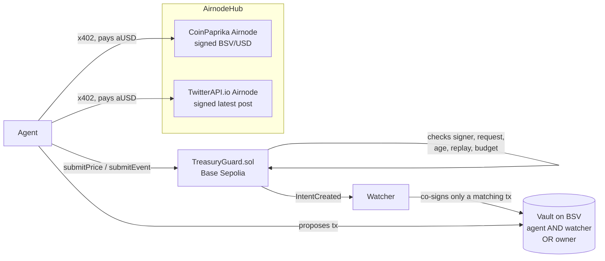

# Treasury Guard (API3 part)

**A dollar budget and a crash guard for AI agents that pay in sats, enforced by signed API3 data.**

AI agents pay in sats, but their owners think in dollars and fear volatility, runaway spending and fake news. Treasury
Guard keeps the agent's money in a vault on BSV that the agent can only move together with a watcher, and the owner can
always exit alone. The watcher co-signs only what `TreasuryGuard.sol` on Base Sepolia allowed, and the contract allows
something only after it verified signed AirnodeHub data: a BSV/USD price (CoinPaprika) or a post of a whitelisted X
account (TwitterAPI.io).

This folder is the API3 part: the contract, its tests, a TypeScript client and the judge script. It runs and can be
judged on its own, without the BSV side.

|                     |                                                                                                                                                             |
| ------------------- | ----------------------------------------------------------------------------------------------------------------------------------------------------------- |
| Network             | Base Sepolia (chain id 84532)                                                                                                                               |
| Contract (verified) | TreasuryGuard [`0x8e38cc6B1Bd1f0D25357066cd0036f28fd1f7773`](https://sepolia.basescan.org/address/0x8e38cc6b1bd1f0d25357066cd0036f28fd1f7773)               |
| Signed data         | CoinPaprika `getTickersById` (BSV/USD price + 1h change), TwitterAPI.io `userLastTweets` (latest post), both bought per call via x402 in aUSD               |
| Tamper test         | live on Base Sepolia, all cases pass ([valid SPEND tx](https://sepolia.basescan.org/tx/0x8426f2416e45e2f44cceaaea392dcc84d8c991913d4a833b52f6f628953c574a)) |
| Tests               | `forge test` 122 tests, `pnpm test` 24 tests                                                                                                                |
| Live demo           | [How to run the live demo](#live-demo-runbook)                                                                                                              |

## Contents

- [What the contract does](#what-the-contract-does)
- [How it fits together](#how-it-fits-together)
- [Who relies on the data, and what goes wrong if it is forged](#who-relies-on-the-data-and-what-goes-wrong-if-it-is-forged)
- [Deployment](#deployment)
- [Setup](#setup)
- [Tamper test](#tamper-test)
- [Live demo runbook](#live-demo-runbook)
- [For integrators: the TypeScript client](#for-integrators-the-typescript-client)
- [Data we could not find on AirnodeHub](#data-we-could-not-find-on-airnodehub)
- [Real vs demo](#real-vs-demo)
- [Repository layout](#repository-layout)
- [Roadmap](#roadmap)

## What the contract does

1. **Dollar budget, paid in sats.** The owner sets a daily budget in USD. `submitPrice` turns a USD amount into a
   SPEND intent with `maxSats = usdAmount / signed price` and debits the budget at once. A new price never resets the
   budget, an unused intent is never refunded, and the budget resets once per UTC day.
2. **Circuit breaker.** The same signed price carries the 1h change. At or below the owner's threshold (−5 %) the vault
   goes `RISK_OFF` and a SWAP intent (sats → stablecoin, 50 % of the vault) is created inside a band around the signed
   price. Re-entry only after a 1 h cooldown and a signed +1 %. No LLM in this path.
3. **News guard.** A signed post of a whitelisted account, a signed price and an analyst verdict can create a hedge
   intent capped at 25 % of the vault (`GUARDED`). Retweets and posts older than 30 min are rejected, and each post
   counts once.

An intent is only an authorization: it says how much may move, in which direction, in which price band, until when. The
watcher on the BSV side co-signs only a transaction that matches it.

## How it fits together



Without a verified price there is no intent, without an intent the watcher does not co-sign, and without both
signatures only the owner can move the money.

## Who relies on the data, and what goes wrong if it is forged

| Who                 | Relies on                                                                                                    |
| ------------------- | ------------------------------------------------------------------------------------------------------------ |
| Owner               | the USD budget is converted to sats at a price nobody could pick                                             |
| Watcher (BSV side)  | it co-signs a BSV tx only if it matches an intent on Base (`maxSats`, `maxBps`, band, expiry)                |
| Liquidity providers | a swap only fills inside `minOut`/`maxOut`, the signed price ∓ slippage                                      |
| Auditors, anyone    | every intent stores the price and when it was signed, every accepted value is an event with its request hash |

If the data could be forged:

- **Forged low price** → `maxSats` grows → the agent overspends in sats while staying "within" its dollar budget.
- **Forged 1h change** → a needless hedge (swap fees, wrong position), or a real crash that never trips the breaker.
- **Forged price in a swap** → the band moves and the LP or the vault trades at a wrong rate.
- **Forged, old or retweeted post** → a hedge on news the account never posted, or posted hours ago (capped at 25 %).

So for every response the contract checks:

- the request hash against the one stored per vault, never the one in the response;
- the signer against the stored Airnode address;
- the signature age (5 min);
- the age of the measured value (10 min) and of the post (30 min);
- replay: a price must be newer than the last one, and a post id counts once.

**What a signature does not prove.** An API3 signature proves who said what, when, and that the data was not changed.
It does not prove the content is true. That is why the larger rule-based moves (budget, breaker hedge 50 %) use only
signed price data, and the post-driven hedge is capped at 25 %. The analyst verdict is signed off-chain; only its hash is
emitted in `PostVerified`, it is not verified on-chain.

## Deployment

All addresses live in [`deployments.json`](deployments.json), which the agent, the watcher and the judge script read.

|                   |                                                                                                                                                                                                                                      |
| ----------------- | ------------------------------------------------------------------------------------------------------------------------------------------------------------------------------------------------------------------------------------ |
| Contract          | [`0x8e38cc6B1Bd1f0D25357066cd0036f28fd1f7773`](https://sepolia.basescan.org/address/0x8e38cc6b1bd1f0d25357066cd0036f28fd1f7773), verified                                                                                            |
| Deploy            | tx [`0xfc0219e4…`](https://sepolia.basescan.org/tx/0xfc0219e499276dc10e6bdfd3f8005158ebaa14f02957dc86fd355c440c7ed884), block 52226250                                                                                               |
| Vault 5           | **the real vault** for the team's agent loop, $1/day, tx [`0x8500b5dd…`](https://sepolia.basescan.org/tx/0x8500b5dd6ceed76c867b2029a58e6f460b302b1a5663f4d7437bf824247c2e5a)                                                         |
| Vault 6           | judge vault (agent = deployer, $100/day counter, no funds behind it), used by the judge script and the video, tx [`0x3b32dc30…`](https://sepolia.basescan.org/tx/0x3b32dc30f9701ef9e3fac4a3c7fa956a2b677b09ab78f415465b956ac91cd893) |
| Vault 7           | second judge vault, same config, kept unused for the one live hedge at judging (`--live`), tx [`0xd5b27df1…`](https://sepolia.basescan.org/tx/0xd5b27df10225e0999253126dd306684c4f1f57beb15dfcad10a79ded95f1b757)                    |
| Vaults 1–4        | retired, reasons in `deployments.json` → `retiredVaults`                                                                                                                                                                             |
| Price feed        | CoinPaprika BSV/USD, request hash `0x18b78216…399480`                                                                                                                                                                                |
| Whitelisted posts | @WhiteHouse, @federalreserve, demo account @956_kakashi (and @TreasuryGuardDe, see below), full hashes in `deployments.json`                                                                                                         |

Why so many vaults: a vault's config (budget, thresholds, whitelisted accounts, agent key) is immutable, so not even its
owner can loosen the rules later. Every config change therefore meant a new vault. Anyone can create one with
`createVault`.

Vault config (5, 6 and 7): max signature age 300 s, max data age 600 s, max post age 1800 s, cooldown 3600 s, intent TTL
900 s, breaker −5.00 %, re-entry +1.00 %, breaker hedge 50 %, event hedge 25 %, slippage 1 %.

## Setup

You need [Foundry](https://getfoundry.sh), [Node.js](https://nodejs.org) 22.18 or later and [pnpm](https://pnpm.io).

```sh
git clone https://github.com/eujinnl/bsv_hackathon.git
cd bsv_hackathon && git checkout api3 && cd api3
pnpm install
forge test        # 122 tests, no network needed
pnpm test         # 24 tests (client, feeds, tamper builders, ABI drift)
```

To run the judge script against the live contract you need a `.env` (never committed, see `.env.example`):

```sh
PRIVATE_KEY=0x...        # the agent of the vault you run on (it pays the gas, ~0.000003 ETH per tx)
RPC_URL=https://...      # Base Sepolia RPC; https://sepolia.base.org works but is rate-limited
PAYER_PRIVATE_KEY=0x...  # pays x402 in aUSD (may be the same key); else it is read from .env.agent
```

Test ETH: Coinbase CDP faucet. aUSD: the [AirnodeHub faucet](https://api3dao.github.io/airnodehub-hackathon/faucet/).
A price costs 0.001 aUSD, a post 0.01 aUSD.

## Tamper test

Check order for a price: request → signer → signature age → replay → budget, so a cached fixture still shows its own
error. All fixtures in [`test/fixtures/`](test/fixtures/) are real signed responses, bought once via x402.

| Case                      | Input                                        | Expected revert                          | Forge test                                    | Live in judge script   |
| ------------------------- | -------------------------------------------- | ---------------------------------------- | --------------------------------------------- | ---------------------- |
| Valid + fresh             | fresh BSV/USD price, amount ≤ budget         | none, SPEND intent created               | `test_valid_freshPriceCreatesSpendIntent`     | yes (sends a tx)       |
| Edited value              | one digit of `data` changed                  | `SignerMismatch(recovered)` `0x64fd0fbe` | `test_tamper_editedValue`                     | yes                    |
| Wrong key                 | re-signed with a local key                   | `SignerMismatch(that key)` `0x64fd0fbe`  | `test_tamper_wrongKey`                        | yes                    |
| Other request             | CoinPaprika BTC/USD, same signer             | `WrongRequest(0xcadca27a…)` `0x4a161c51` | `test_tamper_wrongRequest_btcInsteadOfBsv`    | yes                    |
| Too old                   | signature older than 5 min                   | `StaleSignature()` `0x480cfdff`          | `test_tamper_tooOld`                          | yes                    |
| Replay                    | the same response twice                      | `Replay()` `0xb5a78004`                  | `test_tamper_replay`                          | yes (not with `--dry`) |
| Over budget               | amount > remaining today                     | `BudgetExceeded(remaining)` `0x19af843d` | `test_tamper_budgetExceeded`                  | yes (simulated)        |
| Old post, fresh signature | @federalreserve, post 16.6 h old when signed | `StalePost()` `0x7f1d2c82`               | `test_tamper_stalePost_oldPostFreshSignature` | Forge only             |
| Retweet                   | @WhiteHouse, text `RT @CENTCOM: ...`         | `NotOriginalPost()` `0x579354d1`         | `test_realRetweetIsNotOriginalPost`           | depends on the post    |
| Valid post                | fresh original post + RISK_OFF verdict       | none, hedge intent (25 %), then `Replay` | `test_event_hedgesCappedAndReplayBlocked`     | yes, with `--post`     |

There are three ways to run it.

**1. Forge, offline.** `forge test -vv` runs every case on the real fixtures (`vm.warp` to their signing time).
`forge test --match-test breaker -vv` shows the circuit breaker with a local test signer (−6.25 % in 1 h → `RISK_OFF` +
50 % hedge, re-entry only after the cooldown).

**2. Any response, no key, no gas.** `checkPrice` and `checkEvent` run the same checks as the writes and can be called
by anyone with `eth_call`:

```bash
TG=0x8e38cc6B1Bd1f0D25357066cd0036f28fd1f7773
F=test/fixtures/coinpaprika-btc-usd.json   # or coinpaprika-bsv-usd.json → StaleSignature, or your own response
cast call $TG 'checkPrice(uint256,(bytes32,uint256,bytes,bytes))((uint256,int256,uint256,uint256))' 6 \
  "($(jq -r .requestHash $F),$(jq -r .timestamp $F),$(cast from-utf8 "$(jq -r .data $F)"),$(jq -r .signature $F))" \
  --rpc-url https://sepolia.base.org
# execution reverted, data 0x4a161c51cadca27a… = WrongRequest(0xcadca27a…)
```

Edit a digit of `data`, swap the signature or bring a fresh price, and the revert tells you which check stopped it.

**3. The judge script, live.** [`src/judge.ts`](src/judge.ts) buys one fresh signed BSV/USD price via x402, runs every
rejected case against the live contract as a free `eth_call`, sends one valid `submitPrice` that creates a real SPEND
intent, then shows `Replay`:

```sh
node --env-file=.env src/judge.ts --dry                 # rehearsal: everything as eth_call, no transaction
node --env-file=.env src/judge.ts                       # real run on judge vault 6: SPEND intent + Replay
node --env-file=.env src/judge.ts --post 956_kakashi    # also the news guard: a REAL hedge, once per vault
node --env-file=.env src/judge.ts --live --post 956_kakashi   # the same on vault 7, kept for live judging
```

| Option                 | Effect                                                                                                 |
| ---------------------- | ------------------------------------------------------------------------------------------------------ |
| `--dry`                | no transaction, the valid case runs as `eth_call`                                                      |
| `--usd <dollars>`      | SPEND amount, default 1                                                                                |
| `--vault <id>`         | another vault (default `judgeVaultId` = 6); it refuses the agent's vault 5                             |
| `--live`               | use `liveJudgeVaultId` = 7                                                                             |
| `--post <account>`     | buy that account's latest post (0.01 aUSD); without `--dry` a fresh original post creates a real hedge |
| `--post-file <r.json>` | a saved post instead of `--post`                                                                       |
| `--file <r.json>`      | a saved price instead of buying one (must be < 4 min old and not yet accepted by the vault)            |

It checks that `PRIVATE_KEY` is the vault's agent before it pays anything, and exits with code 1 if any case fails. To
run it on your own vault, call `createVault` with yourself as agent and pass `--vault <id>`.

## Live demo runbook

The demo shows the API3 part end to end in about 4 minutes: a real signed price → a real intent on Base Sepolia, every
forgery rejected, and the news guard hedging on a real signed post.

**Vault rule.** A real hedge leaves its vault `GUARDED`, so it works once per vault. **Vault 6 is for the video, vault
7 (`--live`) for live judging.** Rehearse only with `--dry`.

### 30 minutes before

1. `cd api3`, terminal font large, two panes: one terminal, one browser.
2. Check the keys have funds (needs only read access):
   ```sh
   cast balance 0x85652193A6f230fC382aF4dA10CBD5DeB589fD9F --ether --rpc-url https://sepolia.base.org   # deployer: gas
   cast call 0xbeA34973e5f67F18F656A2C6070C64326C791808 'balanceOf(address)(uint256)' \
     0x0310dCF1E329FE74fe881ae273E1E1d2784b4cf0 --rpc-url https://sepolia.base.org                    # agent: aUSD (6 decimals)
   ```
   A run needs ~0.00001 ETH and 0.011 aUSD.
3. Rehearse: `node --env-file=.env src/judge.ts --live --dry`. All cases must pass. If the RPC is rate-limited, set a
   keyed `RPC_URL`.
4. Open in the browser: the [contract on Basescan](https://sepolia.basescan.org/address/0x8e38cc6b1bd1f0d25357066cd0036f28fd1f7773#events)
   (Events tab), and `deployments.json` on GitHub.

### 5–10 minutes before

5. Post on **@956_kakashi** (original post: no retweet, no reply, no quote), e.g.
   `[DEMO] Treasury Guard test signal: simulated emergency tariff announcement. Risk-off scenario for our hackathon agent. Not real news.`
   From now on you have 30 minutes. Wait about a minute until TwitterAPI.io sees it, then check once:
   `node --env-file=.env src/judge.ts --live --dry --post 956_kakashi` → the last row must say `accepted`.

### On stage

| Step | Do                                                                                                       | Say                                                                                                                                     |
| ---- | -------------------------------------------------------------------------------------------------------- | --------------------------------------------------------------------------------------------------------------------------------------- |
| 1    | Show the diagram above                                                                                   | "The agent's money sits on BSV; it moves only with a watcher's signature, and the watcher only signs what this contract allowed."       |
| 2    | Run `node --env-file=.env src/judge.ts --live --post 956_kakashi`                                        | "The agent buys a signed BSV/USD price from the CoinPaprika Airnode via x402, a tenth of a cent in aUSD."                               |
| 3    | Point at the first rows                                                                                  | "One digit changed, re-signed with our own key, a BTC response, an old one, too much money: the contract rejects each, before acting."  |
| 4    | Point at `Valid + fresh`                                                                                 | "The real one creates a SPEND intent: one dollar, converted to sats at the signed price, debited from today's budget."                  |
| 5    | Point at the hedge row                                                                                   | "A fresh original post of a whitelisted account plus a risk-off verdict: hedge, capped at 25 %. The LLM can never move more than that." |
| 6    | Point at both `Replay` rows                                                                              | "The same price or post a second time does nothing."                                                                                    |
| 7    | Open a tx link from the output on Basescan, show `IntentCreated`                                         | "This is what the watcher reads: amount, band, expiry, and the signed price it is based on."                                            |
| 8    | Offer: "Change any byte yourself" and run the `cast call` from [Tamper test](#tamper-test) on their edit | "No key, no gas: anyone can check a response against the live contract."                                                                |

### If something fails

| Problem                                           | Fallback                                                                                             |
| ------------------------------------------------- | ---------------------------------------------------------------------------------------------------- |
| The post row says `StalePost` / `NotOriginalPost` | Correct behaviour, say so. For the hedge, post again and rerun on a vault that is still `NORMAL`.    |
| The post row shows a 400 "no value"               | TwitterAPI.io does not see the post yet. Wait a minute; or show the run without `--post`.            |
| "vault already hedged"                            | The vault is `GUARDED` from an earlier hedge. Use the other judge vault, or skip `--post`.           |
| x402 / Airnode down                               | Show `forge test -vv` (same checks on real fixtures) and the earlier live txs linked in this README. |
| RPC errors / rate limit                           | Set a keyed `RPC_URL` (Alchemy, QuickNode).                                                          |
| "too close to the limit" / "already accepted"     | The saved price is used up. Run without `--file` to buy a new one.                                   |

## For integrators: the TypeScript client

The BSV side imports [`src/client/`](src/client/) instead of rewriting contract calls. Full guide with the watcher's
co-sign rules: [`docs/INTERFACE.md`](docs/INTERFACE.md).

```ts
import { createTreasuryGuardClient, usd } from './api3/src/client/treasury-guard.ts';
import { createPayingFetch } from './api3/src/x402.ts';

const guard = createTreasuryGuardClient({ rpcUrl, privateKey: agentKey }); // reads deployments.json
const vaultId = BigInt(guard.deployment.vaultId!);
const price = await guard.fetchPrice(createPayingFetch(agentKey)); // signed, checked off-chain
const { intents } = await guard.submitPrice(vaultId, price, usd(0.5)); // simulated first, rejections are free

// watcher, read-only: every past and new intent of the vault, once each
guard.watchIntents(async (intentId) => console.log(await guard.getIntent(intentId)), vaultId);
```

Units: USD 6 decimals, price 8 decimals (USD per BSV), bps = hundredths of a percent, sats = 1e-8 BSV.

## Data we could not find on AirnodeHub

- **No BSV/USD on Nodary** (155 feeds, checked 29 Oct). We buy BSV/USD from the CoinPaprika Airnode via x402
  (`getTickersById`, `coin_id: bsv-bitcoin-sv`, $0.001 per call in aUSD).
- **No retweet flag in TwitterAPI.io `userLastTweets`.** A retweet only has a `retweeted_tweet` object. Projecting it
  costs ~3.8 KB per response, and projecting `/retweeted_tweet/id` returns HTTP 400 when it is null. We project
  `{id, text}` of `/data/tweets/0` and reject text starting with `RT @` (`NotOriginalPost`). In our sample, 13 of the 20
  newest @WhiteHouse posts were retweets.
- **Posts of a brand-new X account were not visible.** For our new demo account @TreasuryGuardDe, `userLastTweets`
  returned an empty list for 30+ min after a public original post, while an older account's post showed up within
  seconds. So the demo uses the older account @956_kakashi.
- **No machine-readable post time.** `createdAt` comes as `Fri Oct 30 13:00:51 +0000 2026`, not ISO 8601, so the
  contract derives the post time from the tweet id (Snowflake).
- Limitation, not missing data: a value in exponent notation (`-1e-7`) reverts in `ProjectedJson`. Unlikely for a
  percentage; the agent then skips the cycle.

## Real vs demo

- **Real:** the verified contract on Base Sepolia, the Airnode signatures, the x402 payments in aUSD (e.g. the
  [BSV/USD purchase](https://sepolia.basescan.org/tx/0x71b12c9ead04e0891898547b6a1206e4c77dfb6aac73eaa31c716e64a2b1e4c7)),
  the tamper cases on real fixtures and live. The BSV side (vault, watcher, payments) runs on BSV mainnet with tiny
  amounts.
- **Demo:** Base Sepolia, not Base mainnet (x402 in aUSD only exists there). The live vault runs a $1/day budget. The
  stablecoin on BSV is a demo token and not redeemable. One team-run watcher and LP. News-guard demo posts come from
  @956_kakashi, an existing account of the team, labeled as a demo, not an official one. The analyst verdict in the judge
  script is fixed to `RISK_OFF`.
- **Not forced live:** the circuit breaker. A −5 % hour of BSV is rare, and we never loosen thresholds to force it. Its
  logic is shown in the Forge tests; live, it fires only on a real crash.
- The agent loop and the watcher are built by the BSV side of the team on top of the client in
  [`src/client/`](src/client/); they are not part of this folder.

## Repository layout

| Path                                                                          | What                                                              |
| ----------------------------------------------------------------------------- | ----------------------------------------------------------------- |
| `contracts/TreasuryGuard.sol`                                                 | the contract                                                      |
| `contracts/AirnodeV2Attestation.sol`, `ProjectedJson.sol`, `IsoTimestamp.sol` | starter libraries: signature check, JSON field reading, ISO time  |
| `test/TreasuryGuard.t.sol`                                                    | all tamper, budget, breaker and news-guard tests on real fixtures |
| `test/fixtures/`                                                              | real signed responses, bought once via x402                       |
| `script/DeployTreasuryGuard.s.sol`                                            | deploy + vault creation                                           |
| `src/client/`                                                                 | TypeScript client, feeds, tamper builders, ABI                    |
| `src/judge.ts`                                                                | judge / live demo script                                          |
| `deployments.json`                                                            | contract address, vaults, feeds                                   |
| `docs/INTERFACE.md`                                                           | how the agent and the watcher use this part                       |
| `docs/OVERVIEW.md`, `docs/TEAM-BRIEF.md`                                      | the idea in simple words, the full design                         |
| `API3-NOTES.md`                                                               | spike results, exact interface, team decisions                    |
| `docs/STARTER.md`                                                             | the README of the AirnodeHub starter this is built on             |

## Roadmap

- **Stable-first mode.** The vault holds the stablecoin and swaps to sats only for each spend, so there is no price risk
  to guard against. The trade-off: every payment becomes a swap (fees, needs live LP liquidity), and the risk moves to
  the stablecoin issuer. The signed price stays necessary: each swap must fill inside the band around it.
- **Analyst signature on-chain.** `ecrecover` the analyst's verdict over `(tweetId, verdict, vault, nonce)` instead of
  only recording its hash.
- **Second price source** (CoinGecko) as a cross-check before a large move.

Built on the [AirnodeHub hackathon starter](https://github.com/api3dao/airnodehub-hackathon-starter) (upstream `52933ae`).
